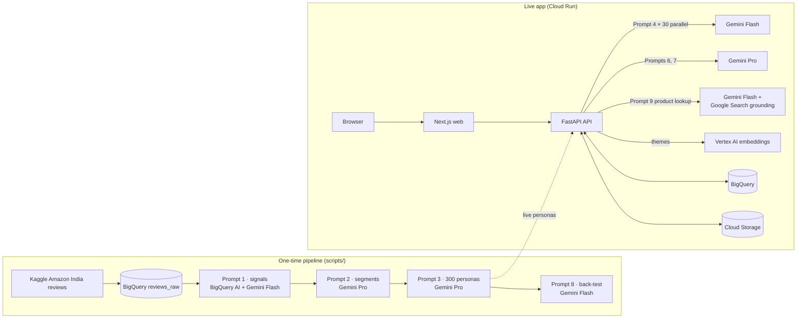
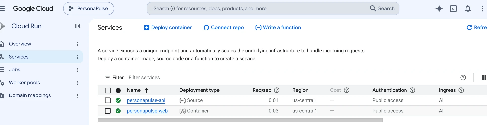
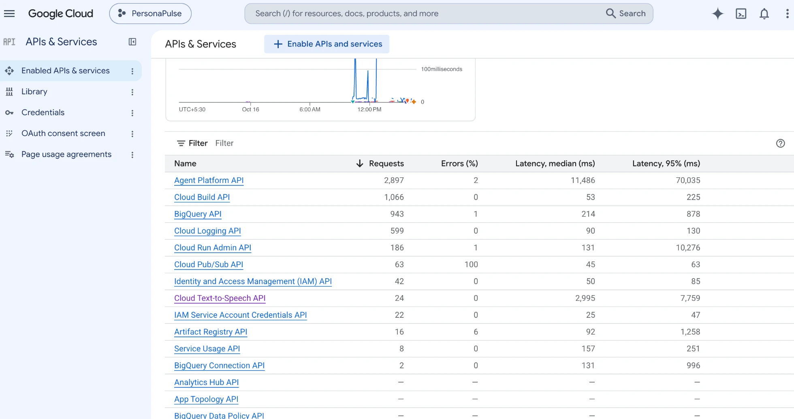

# PersonaPulse

**Self-serve AI focus groups for small businesses, built and proven in India, designed for Asia.** Test a product, price or pack on AI
customers built from real shopper reviews, and see who would buy, at what price, why not, and what to
change, in about a minute instead of weeks.

> All results are **AI-simulated customers**. Personas are built from public product review data.
> PersonaPulse is a fast early filter before real-customer validation, not a replacement for it.

Google Cloud AI Builder Cup 2026 · Retail & Commerce track

| | |
|---|---|
| **Live app** | https://personapulse-web-402218972178.us-central1.run.app |
| Demo test (instant) | https://personapulse-web-402218972178.us-central1.run.app/test/demo |
| Accuracy back-test | https://personapulse-web-402218972178.us-central1.run.app/accuracy |
| **Demo video** (3:32) | https://youtu.be/MPtW9e8ojuU |
| API health | https://personapulse-api-402218972178.us-central1.run.app/health |

No login needed.

## What it does

1. **Describe a product**: name, description, price in ₹, pack size, channel, optional packaging image. Or click an example,
   or type an existing product's name and **Fill from the web** (Gemini with Google Search grounding finds its price,
   specs and competitors).
2. **Pick who tests it**: one of three shopper panels (electronics accessories, home & kitchen, consumer electronics),
   each built only from real reviews in that category. A warning appears if your price is outside the panel's usual range.
3. **30 AI customers react independently, live on Gemini**: would they buy, at what price, what they like, what puts them off.
4. **See results by segment**: purchase intent, willingness to pay vs your price, objection themes, quotes, and an
   AI launch report (verdict, best and weakest segments, price insight).
5. **Improve & retest**: Gemini suggests up to 3 concrete changes; retest any of them on the same customers and compare side by side.

## Results from real runs

**Demo (saved from a live run):** *WeaveCharge 65W USB-C cable*, tested on 30 electronics-accessory shoppers.

| | Would buy | Would buy or consider |
|---|---|---|
| ₹799 | 3% | 17% |
| ₹499 + 1-year warranty (AI-suggested) | 13% | **43%** |

**Back-test (Prompt 8):** 10 products were hidden before personas were built. All 100 accessory personas rated them
from name, description and price only (847 predictions).

| Metric | Result |
|---|---|
| Product pairs ranked in the same order as real buyers | **84%** (36 of 43); a constant baseline can't rank |
| Mean absolute error after calibration (leave-one-out) | **0.20★** vs 0.21★ for always guessing the category average |
| Correlation, predicted vs actual | 0.69 |
| Real top-3 complaints found in the predicted top 5 | 9 of 30 |

Honest caveat: raw predictions are **0.87★ harsher** than Amazon ratings (raw error 0.87★). Online ratings skew high
and the personas are instructed not to be positive by default, so we calibrate the level using the other hidden
products and judge the AI customers mainly on **ranking**, which is what an A-vs-B launch decision needs.

## Architecture



Details, the request lifecycle and the data model: [docs/architecture.md](docs/architecture.md).

**Google Cloud:** Gemini on Vertex AI (with Grounding with Google Search) · BigQuery · BigQuery AI (`AI.GENERATE_TEXT`) · Vertex AI text embeddings ·
Cloud Storage · Cloud Run · Cloud Build · Artifact Registry · IAM service accounts.

### Running on Google Cloud

Both services on Cloud Run (us-central1), public, no login:



API traffic in the project. "Agent Platform API" is Vertex AI (Gemini and embeddings); Text-to-Speech is only used for the demo video's voice-over:



## How the AI customers are built

1. **Real reviews**: 6,878 Amazon India reviews (Kaggle "Amazon Sales Dataset") split into three panels. Reviewer names and IDs are dropped.
2. **Signals (Prompt 1)**: priorities, likes, complaints, price sensitivity and dealbreakers per review. The home & kitchen panel runs inside BigQuery with BigQuery AI.
3. **Segments (Prompt 2)**: 5 decision-based segments per panel with market shares, each including a skeptical group.
4. **Personas (Prompt 3)**: 100 per panel, proportional to segment share. Every persona's "memories" are real reviews copied word for word; 914 of 914 were verified against the source text. The demographic mix matches the target (age, city tier), and about 25% are high-skepticism.

## Guardrails

Every Gemini call has a timeout, one retry on invalid JSON, backoff on rate limits and a Pro → fallback model.
Live tests are capped at 30 personas and drop slow stragglers. Every POST endpoint has a per-IP limit and a daily cap.
The demo and back-test load from bundled JSON with no Gemini calls. No secrets anywhere: authentication is the Cloud
Run service account. See [docs/architecture.md](docs/architecture.md#guardrails-the-hard-rules).

## Repo layout

```
api/      FastAPI (Python 3.11): routers/, services/ (gemini, simulate, insights, themes, storage, bq), prompts/
web/      Next.js (App Router, TypeScript, Tailwind, Recharts)
scripts/  one-time jobs: load_reviews, extract_signals (P1), build_segments (P2), build_personas (P3),
          run_backtest (P8), save_demo, dedupe_names, create_tables, setup_bqai.sh, sync_prompts
docs/     prompts.md (all 9 prompts), architecture.md, deploy.md
```

## Run locally

Prereqs: Python 3.11+, Node 24, gcloud CLI, a GCP project with billing, Vertex AI and BigQuery.

```bash
gcloud auth application-default login   # ADC; no API keys anywhere
cp .env.example .env                    # fill in GCP_PROJECT, GCS_BUCKET
```

API (http://localhost:8080):

```bash
cd api
python3 -m venv .venv && source .venv/bin/activate
pip install -r requirements.txt
set -a; source ../.env; set +a
uvicorn app.main:app --reload --port 8080
```

Web (http://localhost:3000):

```bash
cd web
cp .env.example .env.local
npm install
npm run dev
```

## Data pipeline (one time)

Put the Kaggle "Amazon Sales Dataset" at `data/raw/amazon.csv` (git-ignored), then:

```bash
cd scripts
python3 -m venv .venv && source .venv/bin/activate
pip install -r requirements.txt
python create_tables.py                        # dataset + 8 tables
python load_reviews.py                         # split packed reviews, 3 panels, hide 10 back-test products
./setup_bqai.sh                                # BigQuery AI connection + remote Gemini model
python extract_signals.py --panel accessories  # Prompt 1 via Vertex AI
python extract_signals.py --panel electronics
python extract_signals.py --panel home --engine bigquery   # Prompt 1 via BigQuery AI
python build_segments.py                       # Prompt 2
python build_personas.py && python dedupe_names.py         # Prompt 3
python extract_signals.py --holdout-only       # real complaints of hidden products
python run_backtest.py                         # Prompt 8 -> api/app/data/backtest.json
python save_demo.py <test_id>                  # save a real test as the instant demo
```

Every script takes `--dry-run`, which prints the exact prompt it would send.

## Prompts

All Gemini prompts live in [docs/prompts.md](docs/prompts.md) (Prompts 1–9). `python3 scripts/sync_prompts.py`
copies them verbatim into `api/app/prompts/` (`--check` verifies they match). Prompt 5 (focus group) is included
but not used in this version.

## Deploy

Cloud Run, step by step: [docs/deploy.md](docs/deploy.md).

## Markets: India first, Asia next

Today every AI customer comes from Amazon India reviews, with prices in ₹. A new market needs no new model or
prompts: load that market's reviews, run the pipeline, and the panel is rebuilt with local shoppers. Personas
already carry a preferred language (Hindi, Tamil, Bengali and more were generated); quotes are kept in English
for now and can be switched to the shopper's language with one setting (`QUOTE_LANGUAGE`).

## Limitations

- Personas are only as good as the reviews behind them: three Amazon India categories. Food, fashion and beauty
  would need their own panels, ideally from a business's own reviews.
- Review writers skew to extremes and the personas rate more strictly than real star ratings; we calibrate levels
  and rely mainly on relative comparisons.
- 30 live personas per test keeps cost and latency low; segment percentages are directional, not statistically precise.
- Not built yet: focus-group mode (Prompt 5), Imagen packaging variants, multilingual quotes (supported by the data; switched off).

## Security

Authentication uses Application Default Credentials (the Cloud Run service account). No API keys or secrets are
stored in this repo; `.env`, `.env.local` and credential files are git-ignored and the full git history was scanned
before publishing. Uploaded images are stored in a private bucket with public access prevention.
