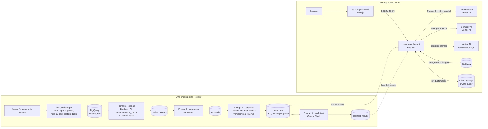

# Architecture

PersonaPulse has two halves: a **one-time data pipeline** that turns real product reviews into
AI customers, and a **live app** where a business tests a product on them in about a minute.

## Google Cloud services

| Service | Role |
|---|---|
| **Gemini on Vertex AI** | All 8 prompts. `gemini-3.8-flash` for high-volume calls (signals, reactions, back-test), `gemini-3.1-pro-preview` for reasoning (segments, personas, insights, improvements), `gemini-2.5-pro` as automatic fallback |
| **BigQuery** | Every table: reviews, signals, segments, personas, tests, per-persona results, insights, back-test |
| **BigQuery AI** | Prompt 1 for the home & kitchen panel runs inside BigQuery: `AI.GENERATE_TEXT` on a remote Gemini model (2,673 reviews in 54 s) |
| **Vertex AI text embeddings** | `text-embedding-005` groups each test's free-text objections and likes into themes |
| **Cloud Storage** | Uploaded packaging images (private bucket); Gemini reads them by `gs://` URI |
| **Cloud Run** | Two services, web and API, public, scale to zero |
| Cloud Build, Artifact Registry | Build and store the container images |
| IAM service accounts | The API's identity for Vertex AI, BigQuery and Storage (no API keys anywhere) |

## A live test, step by step (`POST /tests`)

1. **Validate** the product (lengths, price, panel) and the optional image (real PNG/JPEG/WebP bytes, under 3 MB).
   The image goes to Cloud Storage.
2. **Load the panel's 30 live personas** from BigQuery (cached in memory for 10 minutes, warmed on startup).
3. **Prompt 4 × 30 in parallel**, one call per persona with the image attached. Each call has a 20 s limit and one
   retry; once 90% have answered we wait at most 6 s more (hard cap 55 s). Every answer is validated and normalised.
4. **Group themes** with text embeddings, aggregate by segment (purchase intent, willingness to pay, objections, quotes),
   and save to BigQuery (`tests`, `simulation_results`, `insights`).
5. **Return the result** (about 35 s). **Prompt 6** (insights summary on Gemini Pro) runs in the background; the page
   polls and shows it about 20 s later.
6. **Improve & retest** (`POST /tests/{id}/improve`): Prompt 7 proposes up to 3 variants; retesting one reruns
   steps 3–5 on the same 30 personas and adds a side-by-side comparison.

## Guardrails (the hard rules)

| Rule | How it's enforced |
|---|---|
| No secrets | Application Default Credentials only (Cloud Run service account; `gcloud auth application-default login` locally). `.env*` and credential files git-ignored; full-history secret scan clean |
| Never crash | Timeouts on every Gemini call, one retry on invalid JSON, backoff on 429/5xx, Pro → fallback model, output validation, friendly 503s, global exception handler, frontend error and 404 pages |
| Capped live tests | `MAX_LIVE_PERSONAS=30`; per-IP limit `RATE_LIMIT_PER_MIN=8` and `MAX_TESTS_PER_DAY=300` per instance on every POST; Cloud Run max 3 instances |
| Instant demo | `GET /demo` and `GET /backtest` serve bundled JSON saved from real runs: no Gemini or BigQuery calls |
| No login, clear labels | Public Cloud Run services; every page says "AI-simulated customers" |

## Data model (BigQuery dataset `personapulse`)

| Table | One row per |
|---|---|
| `reviews_raw` | review (panel, product, price, product rating, text, `is_holdout`) |
| `review_signals` | review: Prompt 1 output, engine (`bigquery_ai` or `vertex_python`) |
| `segments` | segment per panel: Prompt 2 output, share |
| `personas` | persona: Prompt 3 output, `is_live` |
| `tests` | tested variant: product, run details, image URI |
| `simulation_results` | persona × variant: Prompt 4 output |
| `insights` | test/variant: Prompt 6 summary, Prompt 7 suggestions, embedding themes |
| `backtest_results` | hidden product: predicted vs actual rating, complaints |
